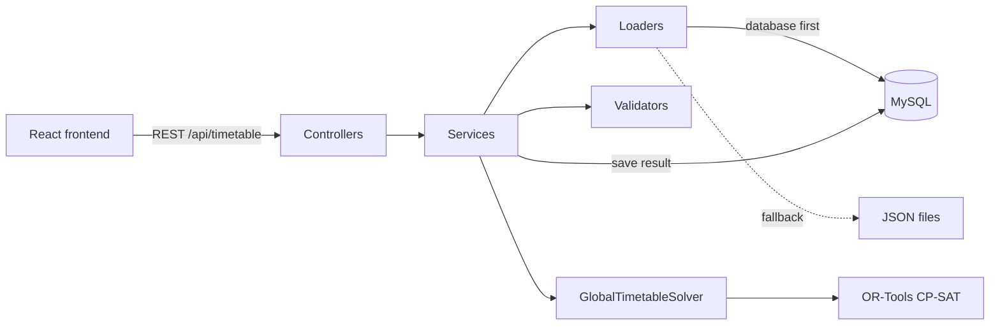
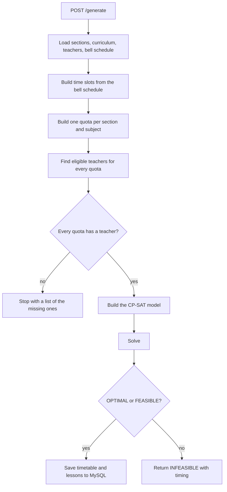

<div align="center">

# RDPL — School Timetable Management System

**Constraint-based generation of conflict-free weekly school timetables.**

Define your school once — teachers, sections, curriculum and bell schedule — and let **Google OR-Tools CP-SAT** place every lesson of every section into the week. Results are stored, browsable by section or teacher, and printable.


[Getting started](#getting-started) · [Architecture](#architecture) · [API reference](#api-reference) · [Troubleshooting](#troubleshooting) · [Roadmap](#known-limitations-and-roadmap)

<br>


</div>

---

## Table of contents

- [Overview](#overview)
- [Screenshots](#screenshots)
- [Technology stack](#technology-stack)
- [Getting started](#getting-started)
- [Architecture](#architecture)
- [Data model](#data-model)
- [Timetable generation](#timetable-generation)
- [API reference](#api-reference)
- [Frontend](#frontend)
- [Project structure](#project-structure)
- [Configuration and security](#configuration-and-security)
- [Troubleshooting](#troubleshooting)
- [Known limitations and roadmap](#known-limitations-and-roadmap)
- [Production-readiness checklist](#production-readiness-checklist)
- [Documentation notes](#documentation-notes)
- [Contributing](#contributing)
- [Support](#support)
- [Licence](#licence)

---

## Overview

RDPL centralises the information required to prepare a school's weekly timetable. Administrators maintain teachers, teacher-to-subject assignments, sections, class-wise curriculum and the bell schedule. The application validates this information and then invokes the CP-SAT solver, which searches for a complete allocation of lessons under the hard constraints described in [Timetable generation](#timetable-generation).

### Key features

- **Master data management** — teachers, assignments, sections, curriculum and bell schedule, editable from the UI or the REST API.
- **Pre-flight validation** — detects missing curriculum mappings and subjects without an eligible teacher *before* the solver runs, and reports exactly what is missing.
- **Conflict-free scheduling** — no teacher and no section is ever booked twice in the same time slot.
- **Timetable history** — every generated timetable and its lessons are stored in MySQL; reopen, filter by academic year, or delete them.
- **Multiple views** — weekly grid by section or by teacher, plain-text output, copy and print.

> [!NOTE]
> **Project status:** pre-production. The API has no authentication and several scheduling rules are stored but not yet enforced. See [Known limitations and roadmap](#known-limitations-and-roadmap) and the [Production-readiness checklist](#production-readiness-checklist) before any real deployment.

---

## Screenshots

| Overview | Checks (data validation) |
|:---:|:---:|
|  |  |
| **Generate** | **Timetable by section** |
|  |  |
| **Timetable by teacher** | **History** |
|  |  |
| **Teachers** | **Classes and subjects** |
|  |  |
| **Bell schedule** | **Database** |
|  |  |

---

## Technology stack

| Layer | Technology |
|---|---|
| Backend | Java 21, Spring Boot 4, Spring Data JPA / Hibernate |
| Scheduling engine | Google OR-Tools Java (`ortools-java`) — CP-SAT |
| Frontend | React 18, Vite 5, React Router |
| Database | MySQL 8 (default database: `rdpl_timetable_db`) |

**Development defaults**

| Item | Value |
|---|---|
| Backend URL | `http://localhost:8085` |
| Frontend URL | `http://localhost:5173` |
| API base path | `http://localhost:8085/api/timetable` |
| Scheduling week | Monday–Saturday, 52 teaching periods |

---

## Getting started

### Prerequisites

| Tool | Version |
|---|---|
| JDK | 21 |
| Maven | Any recent version, or use the included `mvnw` |
| MySQL | 8, running on `localhost:3306` |
| Node.js | 18 or newer (frontend only) |

### 1. Start the backend

```bash
# 1. Review the database settings in src/main/resources/application.properties
#    (the database is created automatically if it does not exist)

# 2. Start the application
./mvnw spring-boot:run
```

On the first start the application:

1. creates all tables (`spring.jpa.hibernate.ddl-auto=update`),
2. copies the JSON files from `src/main/resources/data` into the database,
3. prints `Initial database import finished` in the console.

> [!NOTE]
> From then on **the database is the source of truth**. Editing the JSON files has no effect unless you re-import them (see [Data model](#data-model)).

### 2. Start the frontend

The frontend lives in its own folder, `rdpl-timetable-frontend`.

```bash
cd rdpl-timetable-frontend
npm install
npm run dev          # http://localhost:5173
```

The Vite dev server forwards every `/api` request to `http://localhost:8085`, so no CORS configuration is needed during development.

### 3. Generate your first timetable

1. Open **Checks** in the frontend — all checks should pass.
2. Open **Generate** and press *Generate timetable*. This takes a few seconds to about a minute.
3. Open **Timetable** to view the result by section or by teacher.

---

## Architecture

### System overview



### Generation flow



---

## Data model

### Storage

Everything the solver needs is stored in MySQL.

| Table | Content |
|---|---|
| `master_teachers` | One row per teacher: `teacher_id`, `teacher_name`, `max_periods_per_day`, `max_periods_per_week`, `total_periods_per_week`, `sort_order` |
| `master_teacher_assignments` | What each teacher teaches: class, subject or activity, type, periods per section |
| `master_sections` | Sections: `id`, `class_name`, `section_name`, `grade`, `capacity`, `curriculum_key` |
| `master_curriculum_classes` | One row per class with its weekly totals |
| `master_curriculum_items` | The subjects and activities of each class with periods per week |
| `json_documents` | Configuration documents stored as JSON: `bell-schedule`, `scheduling-rules`, `school-sample`, `teacher-class-assignments` |
| `app_settings` | Academic year and weekly capacity |
| `generated_timetables` | One row per generated timetable (status, academic year, time) |
| `generated_timetable_entries` | The lessons of a timetable: section, subject, teacher, type, day, period |

### Data source setting

| Setting | Behaviour |
|---|---|
| `app.data.source=db` *(default)* | Reads from MySQL. Empty tables are filled from the JSON files at start-up. |
| `app.data.source=json` | Reads the JSON files on every request (legacy behaviour). The database is not used for these tables. |

> [!WARNING]
> To start over from the JSON files, use `POST /api/timetable/data/import` or the **Database** page. This **replaces all data, including your edits**. Back up the database first.

### Data rules

- **Types** are `SUBJECT` or `ACTIVITY` (case-insensitive).
- **Periods in a teacher assignment are per section.** A teacher assigned "Class 2 Mathematics, 9" may teach 9 periods in each Class 2 section. The solver allows up to 9 × (number of Class 2 sections) in total and decides who teaches which section.
- **Names must match the curriculum.** A teacher is eligible for a lesson only when the class, subject or activity name, and the type, match the curriculum item (case-insensitive; spaces around `/` are ignored). Examples: `Games / Library`, `Karate / Gymnastics / Band / Skating`, `G.K. / Moral`.
- **Total periods** of a teacher are always recalculated as the sum of their assignments when saved through the API.
- **Pre-primary sections** currently have no curriculum, so no lessons are generated for them. They are listed under *Checks → Sections without a curriculum*.

---

## Timetable generation

### The week

Time slots are derived from the bell schedule stored in the database.

| Days | Teaching periods |
|---|---|
| Monday to Thursday | 8 per day |
| Friday and Saturday | 10 per day |
| **Total per week** | **52** |

Every curriculum totals exactly 52 periods per week, so each section is fully occupied from the first period to the last.

### Constraints enforced by the solver

- A teacher teaches at most one section in any time slot.
- A section has at most one lesson in any time slot.
- Every section receives exactly the periods its curriculum requires, for every subject.
- A lesson is assigned only to a teacher who is eligible for that class, subject and type.
- A teacher's weekly total per class and subject stays within the assignment (periods × sections).
- A teacher or section has at most as many periods per day as the longest day of the bell schedule.

Rules that are **not** yet enforced are listed under [Known limitations and roadmap](#known-limitations-and-roadmap).

### Solver results

| Status | Meaning |
|---|---|
| `OPTIMAL` / `FEASIBLE` | A complete timetable was found and saved |
| `INFEASIBLE` | No timetable satisfies every rule — usually a teacher is missing or overloaded. Open **Checks** |
| `UNKNOWN` | The time limit was reached |
| `MODEL_INVALID` | The model is invalid. Check the logs |

If a subject has no eligible teacher, the solver does not start. The error lists every class and subject that is missing.

---

## API reference

**Base URL:** `http://localhost:8085/api/timetable`. All responses are JSON unless noted.

<details open>
<summary><b>Master data</b> (endpoints 1–10)</summary>

| # | Method | Endpoint | Purpose |
|---:|---|---|---|
| 1 | GET | `/teachers` | All teachers with assignments |
| 2 | GET | `/teachers/count` | Number of teachers |
| 3 | GET | `/sections` | All sections |
| 4 | GET | `/sections/count` | Number of sections |
| 5 | GET | `/curriculum` | Curriculum of every class |
| 6 | GET | `/curriculum/count` | Number of classes |
| 7 | GET | `/time-slots` | Weekly time slots from the bell schedule |
| 8 | GET | `/time-slots/count` | Number of time slots (52) |
| 9 | GET | `/bell-schedule` | Bell schedule |
| 10 | GET | `/bell-schedule/capacity` | Teaching periods per week |

</details>

<details>
<summary><b>Configuration and quotas</b> (endpoints 11–17)</summary>

| # | Method | Endpoint | Purpose |
|---:|---|---|---|
| 11 | GET | `/load-all-data` | Load and summarise all data |
| 12 | GET | `/school-sample` | Small sample school |
| 13 | GET | `/scheduling-rules` | Scheduling rule set |
| 14 | GET | `/quotas` | One quota per section and subject |
| 15 | GET | `/quotas/validate` | Quota totals against the weekly capacity |
| 16 | GET | `/quotas/missing-sections` | Sections without a curriculum |
| 17 | GET | `/quotas/mapping-report` | How each section maps to a curriculum |

</details>

<details>
<summary><b>Teacher assignments</b> (endpoints 18–19)</summary>

| # | Method | Endpoint | Purpose |
|---:|---|---|---|
| 18 | GET | `/teacher-assignments/eligible?className=Class 1&subjectName=English&type=SUBJECT` | Eligible teachers. `THEORY` is accepted as `SUBJECT` |
| 19 | GET | `/teacher-assignments/unassigned` | Quotas that have no teacher |
| – | GET | `/teachers/assignment-validation` | Summary and warnings for the teacher data |

</details>

<details>
<summary><b>Validation and solver</b> (endpoints 20–22)</summary>

| # | Method | Endpoint | Purpose |
|---:|---|---|---|
| 20 | GET | `/validate` | Validate the input data |
| 21 | GET | `/solver/test?sectionId=&subjectName=&teacherId=` | Place one subject for one teacher |
| 22 | POST | `/generate` | Generate and save a timetable |

</details>

<details>
<summary><b>History and lessons</b> (endpoints 23–30)</summary>

| # | Method | Endpoint | Purpose |
|---:|---|---|---|
| 23 | POST | `/history?academicYear=2026-2027&status=OPTIMAL` | Save a history record manually |
| 24 | GET | `/history` | All timetables |
| 25 | GET | `/history/academic-year/{year}` | Timetables of one academic year |
| 26 | GET | `/history/{id}` | One timetable |
| 27 | DELETE | `/history/{id}` | Delete a timetable and its lessons |
| 28 | POST | `/history/{id}/entries` | Save lessons (JSON array) |
| 29 | GET | `/history/{id}/entries` | Lessons of a timetable |
| 30 | GET | `/history/{id}/entries/count` | Number of lessons (1560 for a full school) |

</details>

<details>
<summary><b>Text timetable</b> (endpoints 31–34)</summary>

| # | Method | Endpoint | Purpose |
|---:|---|---|---|
| 31 | GET | `/text/latest?view=section&id=` | Latest timetable, one grid per section |
| 32 | GET | `/text/latest?view=teacher&id=` | Latest timetable, one grid per teacher |
| 33 | GET | `/text/{historyId}?view=section&id=` | Same, for a saved timetable |
| 34 | GET | `/text/{historyId}?view=teacher&id=` | Same, for a saved timetable |

`id` is optional. It matches a section ID (`class-2-lily`), a teacher ID (`RVS159`) or a name. Omit it to print every grid.

</details>

<details>
<summary><b>Database management</b> (endpoints 35–51)</summary>

| # | Method | Endpoint | Purpose |
|---:|---|---|---|
| 35 | GET | `/data/status` | Row counts and data source |
| 36 | POST | `/teachers` | Create a teacher |
| 37 | GET | `/teachers/{id}` | One teacher |
| 38 | PUT | `/teachers/{id}/assignments` | Replace all assignments of a teacher |
| 39 | PUT | `/teachers/{id}` | Update name, limits and, optionally, assignments |
| 40 | DELETE | `/teachers/{id}` | Delete a teacher |
| 41 | POST | `/sections` | Create a section |
| 42 | PUT | `/sections/{id}` | Update a section |
| 43 | DELETE | `/sections/{id}` | Delete a section |
| 44 | PUT | `/curriculum/{className}` | Create or replace a class curriculum |
| 45 | GET | `/curriculum/{className}` | One class curriculum |
| 46 | DELETE | `/curriculum/{className}` | Delete a class curriculum |
| 47 | POST | `/data/import` | **Destructive:** replace the database with the JSON files |
| 48 | GET | `/data/documents` | List the configuration documents |
| 49 | GET | `/data/documents/{name}` | One document |
| 50 | PUT | `/data/documents/{name}` | Save a document (validated first) |
| 51 | POST | `/data/documents/{name}/import` | Reset one document from its file |

Document names: `bell-schedule`, `scheduling-rules`, `school-sample`, `teacher-class-assignments`.

</details>

### Examples

**Generate a timetable**

```bash
curl -X POST http://localhost:8085/api/timetable/generate
```

**Create a teacher and assign work**

```bash
curl -X POST http://localhost:8085/api/timetable/teachers \
  -H "Content-Type: application/json" \
  -d '{"teacherId":"T100","teacherName":"Asha Rao","assignments":[]}'

curl -X PUT http://localhost:8085/api/timetable/teachers/T100/assignments \
  -H "Content-Type: application/json" \
  -d '[{"className":"Class 1","type":"SUBJECT","subjectOrActivity":"English","periodsPerWeek":8}]'
```

**Print the timetable of one section**

```bash
curl "http://localhost:8085/api/timetable/text/latest?view=section&id=class-1-marigold"
```

### Error format

Errors share one JSON shape across all endpoints:

```json
{ "status": 404, "error": "Not Found", "message": "Teacher not found: T999" }
```

| Status | Meaning |
|---|---|
| `400` | Missing or invalid input |
| `404` | Record not found |
| `405` | Wrong HTTP method for the URL (for example GET on `/generate`) |
| `422` | The data cannot be solved, for example a subject has no teacher |

---

## Frontend

| Page | Purpose |
|---|---|
| **Overview** | Latest timetable and data readiness |
| **Generate** | Run the solver and open the result |
| **Timetable** | Weekly grid by section or teacher, text view, copy, print |
| **History** | List, filter by year, open, delete, add a record |
| **Teachers** | Search, add, delete, edit assignments |
| **Classes and subjects** | Edit curriculum; add or delete sections and classes |
| **Bell schedule** | Period times for every day |
| **Database** | View stored data, edit configuration documents, re-import |
| **Checks** | Data validation, subjects without a teacher, quotas, mapping |
| **Find a teacher** | Eligible teachers for a subject; solver test |

**Production build**

```bash
npm run build        # output in dist/
npm run preview      # http://localhost:4173, also forwards /api
```

To host `dist/` on another server, set `VITE_API_BASE` (see `.env.example`) before building and allow that origin in the backend CORS settings.

---

## Project structure

```text
rdpl-timetable-backend/
├── api-tests/                 API test script and timetable checker
├── docs/
│   └── screenshots/           README images (01-overview.png ... 10-database.png)
├── API.md                     Short API list
├── pom.xml
└── src/main/
    ├── java/rdpl_timetable_backend/
    │   ├── config/            Start-up import, error handler, OR-Tools setup
    │   ├── controller/        REST controllers
    │   ├── dto/               Response objects
    │   ├── entity/            JPA entities for the master data and documents
    │   ├── loader/            Read data (database first, JSON as fallback)
    │   ├── model/             Data classes, including the generated timetable entities
    │   ├── repository/        Spring Data repositories
    │   ├── service/           Business logic, data storage, generation
    │   ├── solver/            Quota builder, time slot generator, CP-SAT solver
    │   ├── constraint/        Constraint classes (not wired into the solver yet)
    │   └── validator/         Data validators
    └── resources/
        ├── application.properties
        └── data/              JSON files used for the first import
```

**Key classes**

| Class | Responsibility |
|---|---|
| `TimetableGenerationService` | Orchestrates the whole generation process |
| `GlobalTimetableSolver` | Builds and solves the CP-SAT model |
| `DataStoreService`, `DocumentStoreService` | Database storage |
| `TimetableTextController` | Text timetable output |

---

## Configuration and security

`src/main/resources/application.properties`:

```properties
server.port=8085
spring.datasource.url=jdbc:mysql://localhost:3306/rdpl_timetable_db?createDatabaseIfNotExist=true&useSSL=false&serverTimezone=Asia/Kolkata
spring.datasource.username=root
spring.datasource.password=...
spring.jpa.hibernate.ddl-auto=update
spring.jpa.open-in-view=false
app.data.source=db
```

- **Do not commit the database password.** Remove it from the file and supply it through environment variables. Spring Boot reads `SPRING_DATASOURCE_USERNAME` and `SPRING_DATASOURCE_PASSWORD` automatically, and they override the file.
- **The API has no authentication.** Anyone who can reach port 8085 can read and modify the data. Do not expose it to the internet in its current state.
- Only a few controllers set CORS (`http://localhost:5173`). In development the Vite proxy makes this unnecessary.
- `ddl-auto=update` is convenient for development. Use a migration tool such as Flyway in production.

---

## Troubleshooting

| Problem | What to check |
|---|---|
| Backend does not start | JDK 21, MySQL running, username and password in `application.properties` |
| `Access denied for user` | Wrong MySQL password. Set `SPRING_DATASOURCE_PASSWORD` |
| `Request method 'POST' is not supported` in the log | A URL was called with the wrong method. Only `generate`, `history`, `history/{id}/entries`, `teachers`, `sections`, `data/import` and the document import accept POST |
| `No eligible teacher found for Class X - Subject` (422) | No teacher has that class, subject and type. Open **Find a teacher** or **Checks** and add one |
| Solver returns `INFEASIBLE` | A teacher has more than 52 periods a week, or too few teachers share a subject. Assign the subject to more teachers |
| Teacher or section not found in the text API | Use the exact ID, for example `class-1-marigold` or `RVS159`, or the full name |
| Frontend shows "Cannot reach the backend" | Confirm the backend runs on 8085. Use `npm run dev`, not a static server, so `/api` is proxied |
| Edited a JSON file but nothing changed | The database is the source of truth. Use the **Database** page or `POST /data/import` |
| Hibernate cannot create tables | The MySQL user needs `CREATE`, `ALTER` and `INDEX` privileges |

---

## Known limitations and roadmap

### Known limitations

- **Teacher data needs review.** Class 6 to 12 English currently uses a placeholder teacher (Hema Pahuja, `E2887`) because the listed English teachers cannot cover all periods. Replace this with a real English teacher on the **Teachers** page.
- **Teacher limits are stored but not enforced.** `max_periods_per_day` and `max_periods_per_week` are kept in the database but the solver does not use them. Today only the 52 slots limit a teacher's week, so some teachers can end up with a full week and no free period.
- **Soft rules are not applied.** The rules in `scheduling-rules.json` (for example no repeated subject on a day, maximum consecutive periods, preferred periods) are stored and shown but not used by the solver. The classes in `constraint/` are not connected.
- **Teacher availability and rooms** are not modelled.
- **Pre-primary classes** have no curriculum and therefore no timetable.
- **Manual changes** to a generated timetable (lesson swapping) are not available.
- **No authentication.**
- The constraint model was checked against an independent OR-Tools replica that produced a conflict-free timetable for the current data.

> [!IMPORTANT]
> Do not treat stored configuration values as enforced constraints unless the solver actually uses them.

### Roadmap

- [ ] Enforce teacher daily and weekly limits
- [ ] Apply the soft rules from `scheduling-rules.json`
- [ ] Pre-primary curriculum
- [ ] Lesson swapping with conflict checking
- [ ] PDF and Excel export
- [ ] Authentication and roles (admin, teacher)
- [ ] Database migrations with Flyway

---

## Production-readiness checklist

Before deploying for real school operations, work through each item:

- [ ] Configure database credentials through environment variables or a secret manager.
- [ ] Add authentication and role-based authorisation.
- [ ] Restrict CORS to the actual frontend origin.
- [ ] Serve the backend over HTTPS behind a production reverse proxy.
- [ ] Replace `spring.jpa.hibernate.ddl-auto=update` with a controlled migration strategy.
- [ ] Configure database backups and a tested restore procedure.
- [ ] Review placeholder teacher data and confirm every curriculum assignment.
- [ ] Decide on and implement teacher daily/weekly limits and soft scheduling rules.
- [ ] Confirm logs do not expose credentials or sensitive school information.

---

## Documentation notes

- This README documents the behaviour and endpoints described in the project documentation. It does not claim that every endpoint or deployment scenario has been tested in every environment.
- The API inventory is the documented endpoint list for this codebase. Confirm controller mappings and request DTOs in the current source before using it as an external integration contract.
- `POST /api/timetable/data/import` replaces database data from the JSON documents. Treat it as a destructive administrative operation and back up the database first.

---

## Contributing

1. Create a branch: `git checkout -b feature/short-name`
2. Make your change
3. Commit and open a pull request

---

## Support

When reporting a bug, please include:

1. The backend and frontend versions or commit.
2. The exact API method and URL, if applicable.
3. The response status and body.
4. Relevant backend console output, with passwords, tokens and personal data removed.

---

## Licence

This project does not yet declare a licence. Add a `LICENSE` file (for example MIT or Apache-2.0) and update this section before distributing the software.

---

<div align="center">

**RDPL School Timetable Management System**
*School data management · Constraint-based scheduling · Timetable history*

</div>